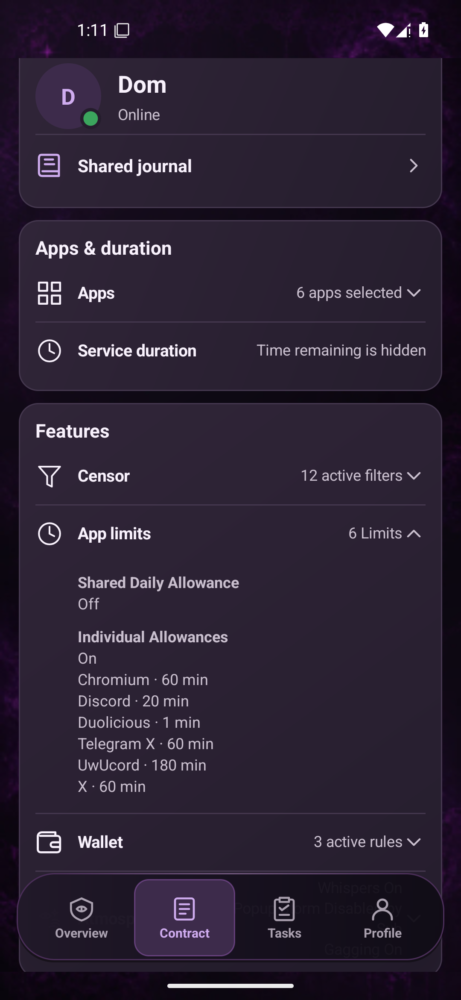
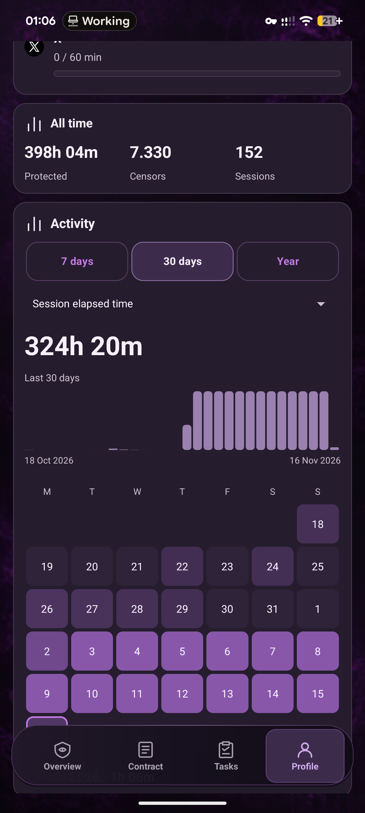
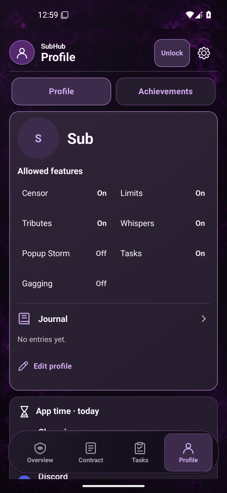
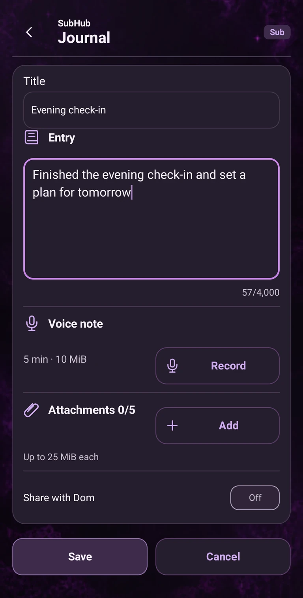

# SubHub

**One Android app for a shared Dom/Sub dynamic.** Set a contract for what happens on the Sub’s device, schedule tasks, and follow sessions from separate Dom and Sub workspaces. Use both workspaces on one device or pair two Android devices. Pairing uses no central account.

[Download the latest stable APK](https://github.com/nyxbydesign/SubHub/releases/latest) · [Pair two devices](docs/remote-pairing.md) · [Build from source](#build-and-contribute)

<p align="center">
  <a href="docs/screenshots/overview/sub-contract.webp"></a>
  &nbsp;
  <a href="docs/screenshots/overview/sub-stats.webp"></a>
</p>

<p align="center"><em>App allowances on the paired Sub and activity statistics captured on a Pixel.</em></p>

<p align="center">
  <a href="docs/screenshots/overview/sub-profile.webp"></a>
  &nbsp;
  <a href="docs/screenshots/overview/journal-editor.webp"></a>
</p>

<p align="center"><em>Sub profile and an example Journal entry with sharing off.</em></p>

## What you can do

- **Set and follow a contract.** The Dom selects a Sub and sets the included apps, session duration, and rules for features the Sub allows. The Sub can see the applied rules, today’s allowances, and session status. For paired devices, check that a contract change was applied before relying on it.
- **Schedule and review tasks.** Assign a one-time or recurring task with instructions and optional media. The Sub can submit text or media for review, or request review outside the app. The Dom explicitly approves or declines it. See [Tasks](docs/tasks.md) for deadlines, refusals, and what happens offline.
- **Keep a Journal.** Both roles have a private Journal for text, voice notes, and attachments. Share individual entries with your currently paired Dom or Subs. Shared entries open read-only and arrive when the devices reconnect.
- **Shape a session.** Censor detects explicit imagery and text on the device and draws a configurable overlay. Limits gives selected apps individual allowances, a combined daily budget, or both. Atmosphere adds Whispers, Popup Storm, or the optional Gagging keyboard; Android lets you switch back to your usual keyboard.
- **Settle Tributes if you use them.** Optional Wallet rules assess amounts for selected events, subject to configured caps. An assessed Tribute is separate from a completed PayPal payment. Saved-wallet auto-pay requires separate consent on the Sub device. See [Wallet and payments](docs/paypal-penance.md) and [PayPal setup](docs/paypal-setup.md).
- **Review activity and progress.** The Dom can review grouped activity from linked Subs, including tracked app opens, reached limits, triggered Tributes, and verified payments. Profiles show available statistics, history, and achievements. A cached update is not a live reading of another device.

## Get started

1. Install SubHub on **Android 8.0 or newer**. Use the file ending in `-universal.apk` if you’re unsure which APK to use, or choose the smaller package with your device’s ABI (`arm64-v8a` for most recent Android phones). The release includes SHA-256 checksums. Android may ask you to allow installation from the app that opened the APK.
2. Choose **Sub**, **Dom**, or **Both** during setup. Dom-only devices do not need local protection access. On a single device, **Both** gives you separate workspaces; configure a controller PIN to unlock Dom.
3. To link two devices, open **Subs → Add Sub** on the Dom device and share the invitation privately. On the Sub device, use **Pair with Dom** in setup or under **Settings → Keyholder**. Compare fingerprints and approve both sides. See [pairing and recovery](docs/remote-pairing.md) for details.
4. Open the selected Sub’s **Contract** in Dom to configure the rules. Select **Atmosphere** to open a page with panels for Whispers, Popup Storm, and Gagging. Each panel shows its controls when open. In Sub, review the applied Contract and allow the Android access needed by the features you choose. Granting access is a separate step on the device that runs the session.

Upgrades preserve applied settings and artwork from remote-enabled SubHub 0.6.5 builds onward.

For updates, open **Updates** from Settings. Stable is the default. Turn on **Development updates** to see prereleases in the app. Android still asks you to approve installation. Turning the option off keeps the installed version and waits for a newer stable build. You can also download APKs directly from [GitHub Releases](https://github.com/nyxbydesign/SubHub/releases).

## Privacy and control

Image and text detection run on-device. Linked devices exchange supported data over encrypted peer connections; a relay can carry the encrypted traffic when a direct connection isn’t available. There is no central account or stored-message service. Offline changes wait on the devices; Android network and battery restrictions may delay delivery.

The Sub can manage feature participation from their own profile. Optional **Hardcore Mode** adds friction to removing protection without overriding the Sub’s feature choices. Android still controls Accessibility, screen capture, overlays, notifications, and Device Admin. SubHub does not replace Android’s security controls.

The optional **Blackmail** feature can share Android-exposed contacts, messages, notifications, apps, and files with the approved Dom. It requires Hardcore Mode, separate approval on the Sub device, and the relevant Android permissions. Live screen sharing asks for Android consent each time. The Sub can revoke Blackmail even while Hardcore is on. Revocation stops further access; it cannot recall files already downloaded. See [Blackmail details and limits](docs/remote-pairing.md#blackmail).

## Build and contribute

Use **JDK 17** and **Android SDK 35**. From the repository root:

```sh
./gradlew testDebugUnitTest lintDebug assembleDebug
```

On Windows, run `gradlew.bat` with the same tasks. Debug APKs are under `app/build/outputs/apk/debug/`, including `app-universal-debug.apk`. The app source is in [`app/src/main`](app/src/main).

Open changes against `dev`; it is the only branch that publishes prereleases. `master` is the stable release branch. See [contributor and release guidance](AGENTS.md) for CI, versioning, and release verification.

[Architecture](docs/architecture.md) · [Device smoke tests](docs/device-smoke-test.md) · [Archived UI gallery](docs/screenshots/ui-map/README.md) · [Media kit](docs/marketing/README.md) · [License](LICENSE)
