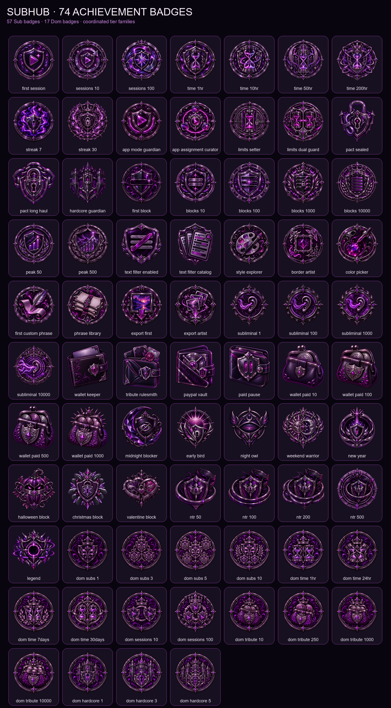

<p align="center">
  
</p>

<p align="center">
  <strong>Set the terms. Hand over control.</strong><br />
  A private Android control space for live censoring, app limits, an optional tribute wallet, and atmosphere.
</p>

<p align="center">
  
  
  
</p>

<p align="center">
  <a href="https://github.com/confiteor48/SubHub/releases/latest"><strong>Download</strong></a>
  &nbsp;·&nbsp;
  <a href="#features"><strong>Features</strong></a>
  &nbsp;·&nbsp;
  <a href="#how-service-works"><strong>How it works</strong></a>
  &nbsp;·&nbsp;
  <a href="docs/screenshots/ui-map/README.md"><strong>Gallery</strong></a>
  &nbsp;·&nbsp;
  <a href="docs/marketing/README.md"><strong>Media kit</strong></a>
  &nbsp;·&nbsp;
  <a href="#build"><strong>Build</strong></a>
</p>

## Overview

SubHub brings the rules, active session, and progress into one Android app. Choose the features that participate, configure them in Dom mode, and hand over to the focused Sub experience.

| Feature | What it does |
|---|---|
| [Censor](#censor) | On-device image and explicit-text detection with configurable overlays. |
| [Limits](#limits) | Individual and shared daily app allowances. |
| [Wallet / Tribute](#wallet--tribute) | Optional tribute rules, bounded balances, and PayPal settlement. |
| [Atmosphere](#atmosphere) | Subliminal Messaging and Popup Storm, configured independently. |
| [Profiles and Activity](#profiles-and-activity) | Configure each Sub and review recorded activity. |
| [Milestones](#milestones) | Session statistics and illustrated achievements. |

<p align="center"></p>

For pairing, shared contracts, sync timing, and recovery, see [Pairing two devices](docs/remote-pairing.md).

## Features

### Censor

- **App Mode by default.** Accessibility supplies foreground-app awareness and visible-text geometry without a new capture prompt every session.
- **Screen Capture when wanted.** MediaProjection remains an explicit alternate path.
- **Included apps.** Every enabled service feature uses the same include/exclude list in the selected person’s Apps screen.
- **Tracked overlays.** Detected regions use temporal tracking. Live stability and responsiveness depend on the workload and device; UI screenshots are not performance benchmarks.
- **One render system.** Blackout, Blur, Pixelate, Custom Image, TV Static, Glitch, Privacy Tape, and Lockpad share the tracked overlay pipeline.
- **Appearance presets.** Open Presets from the Appearance card or export appearance editor to choose 15 built-in looks or save your own. Saved looks can be renamed, updated or deleted. A preset changes appearance only in the editor you opened; detection settings stay separate.

Three detection levels—Low, Medium, and High—offer Balanced Coverage, More Coverage, and Maximum Coverage. Appearance stays separate: choose one of eight phone-previewed styles, customize colors and borders, and manage images when Custom Image is selected.

<p align="center">
  
  &nbsp;&nbsp;
  
</p>

<details>
<summary><strong>Live image and text filtering examples</strong></summary>

<p align="center">
  
  &nbsp;&nbsp;
  
</p>

</details>

### Limits

Limits shows today's recorded app usage, a combined daily budget, and separate allowances beside each included app. Use either budget or both; the smaller remaining allowance applies. Usage resets at local midnight, and exhausted apps return to Home. Changing the included list preserves the day's recorded combined usage.

<p align="center">
  
</p>

### Wallet / Tribute

Wallet is optional. Rules can count only deliberately enabled events: a new stable temptation, lingering on one still screen, tapping a visible censor, opening an included app, or a rate-limited Hardcore tamper signal. Each rule follows its configured session participation, rates, and caps.

Censor taps require an Android click event whose complete control bounds are covered by the currently displayed censor. Partly covered controls and surfaces that send no click event cannot be attributed reliably, including some video and canvas views. Reverse-mode revealed regions are not censor tap targets. Tap entries require an armed Sub session, the Censor module, and the tap rule to be enabled. Censor Lab recordings never create tap entries, including redraws of retained Lab content after recording stops.

Wallet places the amount due, payment action, and recent ledger in one compact overview. Dom opens Rules & caps, Paid pause, PayPal, or Corrections to configure them; Back returns to the overview. Review what is owed and settle it through PayPal. Merchant credentials and saved-wallet tokens are encrypted with Android Keystore and stay bound to the selected Sandbox or Live environment.

<p align="center">
  
  &nbsp;
  
  &nbsp;
  
</p>

### Atmosphere

#### Subliminal Messaging

Faint randomized phrases can follow service through the shared included-app list. Obedience, focus, beta/cuck, findom, and custom phrase packs run through one touch-through Accessibility overlay—without waking the image detector. Presence, timing, text size, and voice are configured in Dom mode; Sub mode sees only the active summary.

Subliminal Messaging does not require Censor, Limits, or Wallet. Enable it from Atmosphere on the selected profile.

#### Popup Storm

Configure intensity, choose an image library, and try a bounded ten-second preview without enabling service participation. Popup Storm and Subliminal Messaging have separate controls under Atmosphere. Gallery offers a media preview, separate appearance and body-area editors, video position and export controls, and filename-based results. Exports keep originals unless deletion is explicitly selected.

<p align="center">
  
  &nbsp;
  
  &nbsp;
  
</p>

### Profiles and Activity

Dom uses Overview, People, Activity, and Settings. Long-press a Sub in People to mark a favorite. Overview shows that Sub's identity, current session status, and recorded statistics, followed by up to three recently added Subs and recent activity.

Choose a person to configure their apps, feature settings, artwork, and next-session duration. Start and End act on that selected person where authorized. Stats opens usage summaries and history directly. A Sub can read their applied contract and statistics, start an eligible session, settle Tribute, and use allowed pause or safety controls.

Activity records selected-app opens, triggered Tributes, and reached app limits. Notifications open the authenticated Activity feed. Recorded events queue while the paired device is offline; delivery requires the peers to reconnect. Triggered Tributes describe assessed amounts, not successful payments. App-open and app-limit entries require the live Accessibility service on Android 11 or later. Older Dom devices can pair and receive these entries; Tribute entries depend on the source feature that assesses them.

Choose Dom only, Sub only, or Both for this installation. Dom-only devices skip local protection setup. Unlocking a controller session is separate from the device's capabilities. A paired Sub receives settings from its assigned Dom; private payment credentials, Android permissions, and local authentication stay on their device.

Open Journal below About me on your profile to write an entry, record a voice note, or attach files. Entries are private until you choose Share with Dom or Share with Subs. A shared profile opens a read-only Journal. Sharing applies to the currently paired devices; new or renewed pairings do not inherit earlier entries. Both devices need a Journal-compatible app version and must reconnect to exchange shared entries and attachments.

Each entry allows 4,000 characters, one voice note of up to five minutes or 10 MiB, and five attachments of up to 25 MiB each. Microphone access is requested when you tap Record; leaving the editor stops recording. Each role keeps up to 1,000 entries and 256 MiB of copied media. Making an entry private or deleting it withdraws it on the next connection; files someone already exported to another app cannot be recalled.

### Milestones

SubHub includes original illustrated achievements across censoring, protected time, sessions, streaks, customisation, App Mode, limits, service locks, Hardcore Mode, confirmed Wallet payments, and subliminal impressions. Related tiers keep one visual family and grow richer as the target rises.

<details>
<summary><strong>Open the complete badge collection</strong></summary>



</details>

<p align="center"></p>

## How service works

Dom mode holds every rule. Sub mode keeps only the active scene: choose a service duration, enter service, and see the current limits, ledger, session, and milestones without exposing configuration.

| Dom mode | Sub mode |
|---|---|
| Configure modules, included apps, limits, censor appearance, Wallet rules, and Android access. | Start service, follow the timer, review active rules, and settle an enabled Wallet balance. |
| Protected by the controller PIN. | One focused Home surface with no edit fields; Home and Settings remain in the bottom navigation. |

A session begins when service starts—not when SubHub opens—and persists until service ends.

1. Install the universal APK, or the APK matching your device’s ABI, from [Downloads](https://github.com/confiteor48/SubHub/releases/latest).
2. Choose Dom only, Sub only, or Both and configure the local keyholder or pair with a Dom device.
3. Dom selects a person in People and configures their included apps, participating features, limits, and next-session duration. All Apps includes newly installed apps while retaining the individual selection for later.
4. Hand over to Sub mode and start the configured session. A Dom-only installation manages paired Subs without setting up local protection permissions.

Disable a feature and it stops participating in service.

<p align="center"></p>

## Privacy & boundaries

- Detection and text classification run on-device; frames are processed in memory.
- Android remains the authority for Accessibility, screen capture, overlays, notifications, and Device Admin.
- Hardcore Mode adds platform-supported friction. It is not an unbreakable device-security boundary.
- Device Admin requests no wipe, camera, password, force-lock, or login-monitoring policy.
- Censor detection, Limits budgets, and Wallet rules can be turned off independently; their Dom pages remain available.

## Build

Requirements: JDK 17, Android SDK 35, and Android 8.0 or newer.

```powershell
.\gradlew.bat testDebugUnitTest lintDebug assembleDebug
```

Editable source lives under `app/src/main/java/com/subhub/app/`. Versioned tags build, sign, verify, and publish universal and ABI-specific APKs with checksums.

Only pushes to `dev` publish a signed [GitHub prerelease](https://github.com/nyxbydesign/SubHub/releases), with a unique `-dev.<run>` version and the same APK/checksum/updater assets. Develop each feature on its own branch from `dev`, merge its reviewed and tested changes into `dev`, then delete the completed feature branch. Stable releases remain explicitly tagged from `master`; development builds never replace GitHub’s latest stable release.

In the app, open **Updates → Dev updates** in Dom mode to opt in. It is off by default. Checks follow the selected channel, and downloads and Android installation still require your approval. Turning Dev updates off keeps the installed app and waits for a newer stable build—no uninstall, ADB, or external file host is needed for subsequent updates.

## Screenshots & media kit

Browse the [complete current UI gallery](docs/screenshots/ui-map/README.md), including Dom/Sub navigation, app inclusion, Appearance, Wallet, and Atmosphere. Captures use synthetic data on an Android emulator and show the development build; the published APK may differ.

Ready-to-share marketing materials:

- [Square collage — 1080 × 1080](docs/marketing/subhub-social-square.png)
- [Portrait collage — 1080 × 1350](docs/marketing/subhub-social-portrait.png)
- [Wide desktop collage — 1920 × 1080](docs/marketing/subhub-social-wide.png)
- [Editable SVG sources and regeneration instructions](docs/marketing/README.md)

The square and portrait collages feature Censor, Tribute, and Subliminal Messages. All use app screenshots; individual captures and older marketing compositions may show earlier layouts.

## Documentation

- [Architecture](docs/architecture.md)
- [Device smoke test](docs/device-smoke-test.md)
- [PayPal setup](docs/paypal-setup.md)
- [PayPal settlement](docs/paypal-penance.md)
- [Client-only roadmap](docs/client-only-roadmap.md)

<p align="center"></p>

<p align="center">
  <strong>SubHub</strong><br />
  Private control. Clearly handed over.
</p>
