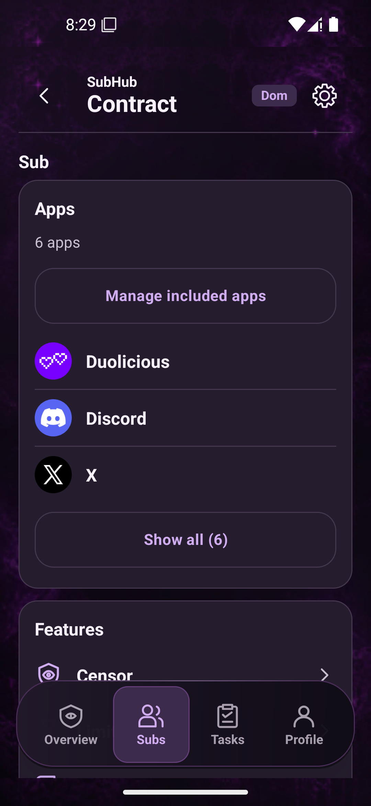
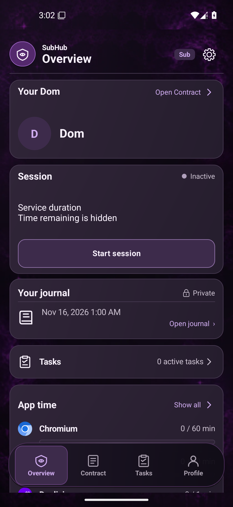
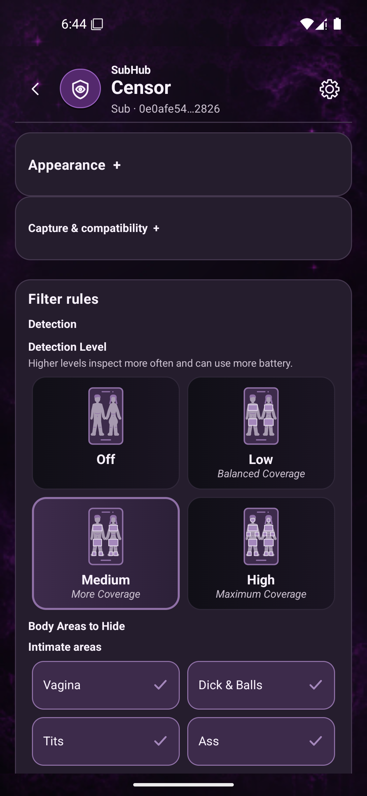
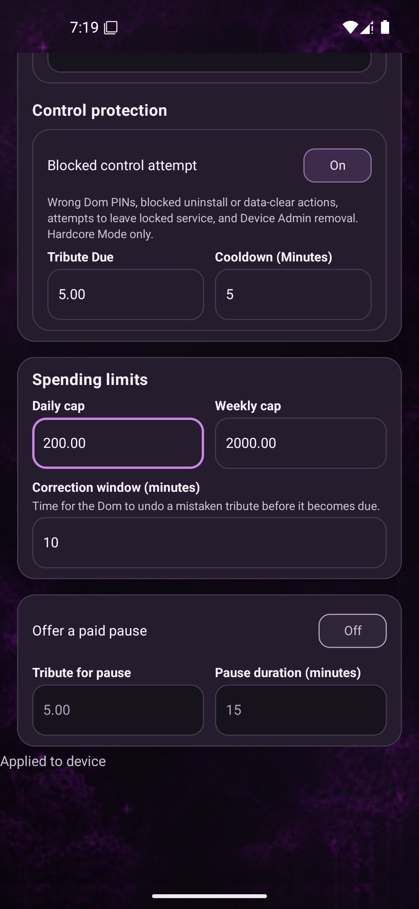
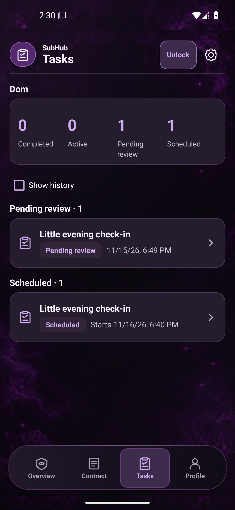
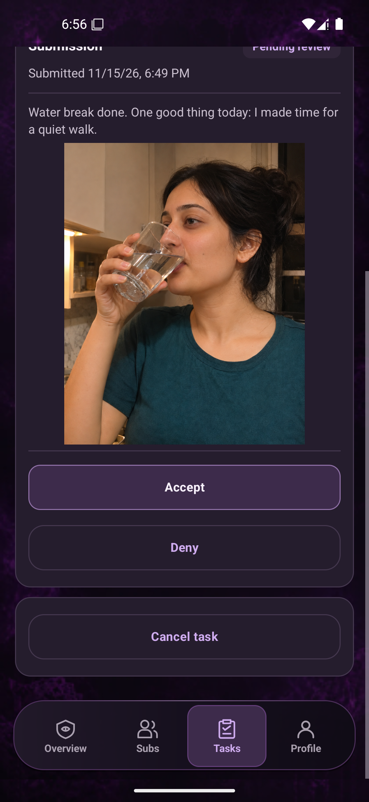
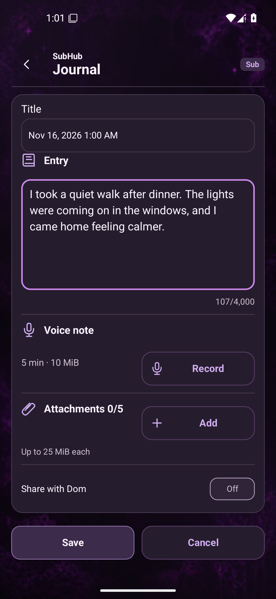

  

<h1 align="center">SubHub</h1>

Set a shared Contract, run sessions, and review tasks from separate Dom and Sub workspaces on Android.

  <a href="https://github.com/nyxbydesign/SubHub/releases/latest"><strong>Download for Android</strong></a> ·
  <a href="docs/screenshots/walkthrough/README.md"><strong>Screen gallery</strong></a> ·
  <a href="docs/remote-pairing.md">Pairing guide</a>

  
  &nbsp;
  

## Start with a pair

1. Install SubHub on **Android 8.0 or newer**. Choose the `-universal.apk` file if you’re unsure which APK to use. Each release includes SHA-256 checksums.
2. Choose **Dom**, **Sub**, or **Both**. Both gives you separate workspaces on one device. Set a controller PIN to unlock Dom.
3. On Dom, open **Subs → Add Sub**. On Sub, choose **Pair with Dom** during setup or under **Settings → Keyholder**. Compare fingerprints on both devices and approve the pair. [Pairing and recovery](docs/remote-pairing.md)
4. Open the selected Sub’s **Contract** on Dom to configure the rules. Review the applied Contract on Sub and grant the Android access needed by the features you use.

## Contract and session controls

Choose the included apps, set individual or shared daily allowances, and configure the next session. Sub shows the applied rules, current allowances, and session status. On linked devices, check that a change was applied before relying on it.

  
  
  

- **Censor** detects explicit images and text on the device and draws a configurable overlay. Choose detection rules, capture settings, and how the overlay looks.
- **Atmosphere** opens from Contract. Whispers, Popup Storm, and Gagging share one page. Whispers opens first, and the open panel shows its controls directly. The Sub’s consent determines which features the Dom can edit.
- **Wallet** handles optional Tributes and spending caps. The Wallet records assessed Tributes separately from completed PayPal payments. Saved-wallet auto-pay requires separate consent on Sub. [Wallet and Tributes](docs/paypal-penance.md) · [PayPal setup](docs/paypal-setup.md)

## Tasks, Journal, and progress

Assign one-time or recurring tasks with instructions and optional media. Sub can submit text or a photo, or request review outside the app. Dom approves or declines each submission. [Task delivery and review](docs/tasks.md)

  
  
  

Both roles have a Journal for text, voice notes, and attachments. Share entries individually with paired people. Profile shows the available statistics, activity history, and achievements. [See both workspaces and the settings screens](docs/screenshots/walkthrough/README.md)

## Privacy and control

Detection runs on-device. Paired devices exchange supported data over encrypted peer connections. A relay can carry the encrypted traffic when a direct connection is unavailable. Pending changes stay on the devices until they reconnect.

The Sub can manage feature participation from their own Profile. Optional **Hardcore Mode** makes protection harder to remove and still honors those feature choices. Android controls access to Accessibility, screen capture, overlays, notifications, and Device Admin.

The optional **Blackmail** feature requires Hardcore Mode, separate Sub approval, and the relevant Android permissions. Live screen sharing asks for Android consent each time. The Sub can revoke future access. [Sharing permissions and limits](docs/remote-pairing.md#blackmail)

## Updates and development

Stable releases are the default. Turn on **Development updates** in Settings → Updates to see prereleases. Release cards start expanded. With Development updates on, stable cards start collapsed. When you turn Development updates off, the installed build stays in place until a newer stable build is available. Upgrades preserve applied settings and artwork from remote-enabled SubHub 0.6.5 builds onward.

Build with JDK 17 and Android SDK 35. Run `./gradlew testDebugUnitTest lintDebug assembleDebug` from the repository root. On Windows, use `gradlew.bat`. The universal debug APK is under `app/build/outputs/apk/debug/`.

Open changes against `dev` for prereleases. `master` is the stable release branch. [Build and release guidance](AGENTS.md) · [Architecture](docs/architecture.md) · [License](LICENSE)
